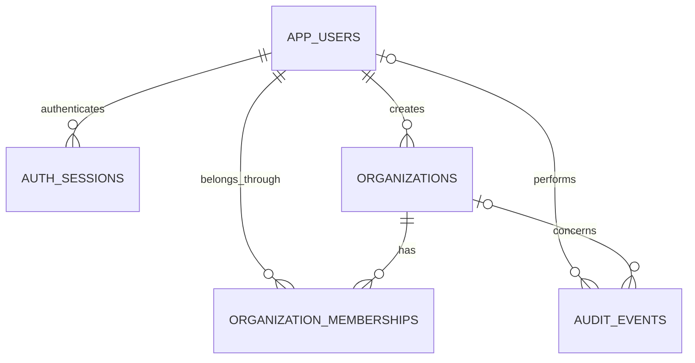

# Zaza backend

Java 24 / Spring Boot 4.1.1 / PostgreSQL. The existing Gradle wrapper is retained.

## Code structure

All features use shared layer packages under `src/main/java/com/zaza/housing`:

```text
controller/  HTTP endpoints; delegate to services
service/     Business rules, authorization, transactions
repository/  SQL, persistence, row mapping
model/       Domain records
dto/         Request and response types, one public type per file
enums/       Domain enums
config/      Spring/security configuration
filter/      Authentication and rate-limit filters
security/    Security response helpers
exception/   API errors and exception handling
util/        Pagination, email normalization, token hashing
```

Extend the relevant existing layer classes for new behavior. Controllers/services do not contain request or response records, controllers do not query repositories directly, and service classes do not contain SQL. `AGENTS.md` records these conventions for future changes.

Private property and rental-unit management is now implemented. See [the property management guide](docs/property-management.md) and `api/property-management.http` for ownership, agency delegation, pricing, availability, version checks, and archival.

Rental listing drafts/publication and guest search are implemented in [the public listings guide](docs/public-listings.md), with examples in `api/public-listings.http`. Guest GET `/api/v1/listings` exposes only explicitly published, currently available offers.

Private property image uploads and approved public galleries are implemented in [the images guide](docs/property-images.md) and `api/property-images.http`. JPEG/PNG photos are resized, normalized, and stripped of original metadata. Configure private local storage with `ZAZA_IMAGE_DIRECTORY` (default `.local-images`).

## Start locally

PostgreSQL must already contain database `zaza` and login `admin`, with permission to create tables and functions in the database's `public` schema. The service does not create or replace database users or databases. Flyway creates and versions the foundation tables on startup; it refuses an existing nonempty schema without migration history rather than automatically baselining it.

From the project folder in PowerShell:

```powershell
.\scripts\start-local.ps1
```

Copy `.env.example` to `.env` and fill in `ZAZA_DB_PASSWORD`, or supply it through your environment/secret manager. The backend imports `.env` as a Java properties file: use `KEY=value` without surrounding quotes; literal backslashes must be escaped as `\\`. Keep `.env` out of Git. The startup script prompts without displaying or saving the password if neither source provides it. Configuration variables:

| Variable | Default |
| --- | --- |
| `ZAZA_DB_URL` | `jdbc:postgresql://localhost:5432/zaza` |
| `ZAZA_DB_USER` | `admin` |
| `ZAZA_DB_PASSWORD` | Required; no default |
| `ZAZA_BIND_ADDRESS` | `127.0.0.1` |
| `ZAZA_PORT` | `8080` |
| `ZAZA_BUILD_DIR` | Optional override for Gradle's output directory |
| `ZAZA_SESSION_DURATION` | `PT1H` (maximum `P1D`) |
| `ZAZA_AUTH_REQUESTS_PER_MINUTE` | `20` per client IP across registration/login |
| `ZAZA_CORS_ORIGINS` | `http://localhost:3000,http://localhost:5173` |

Projects stored under OneDrive automatically build under Gradle's local user cache (`.gradle/zaza-build/housing-<project-key>`) to avoid cloud synchronization locking generated files. Other projects use the usual `build/`. `ZAZA_BUILD_DIR` can override either choice; set it in your process environment, since Gradle itself does not import `.env`.

The app binds to localhost by default. Set the exact Flutter web origin in `ZAZA_CORS_ORIGINS` when connecting the frontend. Production needs HTTPS termination, appropriately configured proxy/client-IP handling, and a shared rate limiter when using multiple instances. The current limiter intentionally uses the direct peer address, not untrusted forwarding headers.

## API

Structured requests/responses use JSON; image/video uploads use multipart form data and content routes serve media bytes. Private APIs require `Authorization: Bearer <accessToken>`.

`api/foundation.http` contains editable example requests for IntelliJ's HTTP client. Replace the example variables with your own local test account; keep real credentials and tokens in the client's private environment rather than committing them to the request file.

| Method | Path | Access |
| --- | --- | --- |
| GET | `/actuator/health` | Public; no database details exposed |
| POST | `/api/v1/auth/register` | Public; creates a regular account |
| POST | `/api/v1/auth/login` | Public; returns an expiring bearer token |
| POST | `/api/v1/auth/logout` | Signed in; revokes the current token |
| GET | `/api/v1/me` | Signed in; own account |
| GET / POST | `/api/v1/organizations` | Signed in; list own organizations / create one |
| GET | `/api/v1/organizations/{id}` | Member of that organization |
| PATCH | `/api/v1/organizations/{id}` | Organization owner or administrator |
| GET / POST | `/api/v1/organizations/{id}/members` | Organization owner or administrator |
| PATCH / DELETE | `/api/v1/organizations/{id}/members/{userId}` | Authorized member manager |
| GET | `/api/v1/admin/users` | Platform administrator; account summaries only |

List APIs accept `limit` (1-100, default 50) and `offset` (nonnegative).

Registration body:

```json
{"email":"you@example.com","password":"choose-your-own-long-password","displayName":"Your name"}
```

Login body:

```json
{"email":"you@example.com","password":"choose-your-own-long-password"}
```

Login returns `accessToken`, `tokenType`, `expiresAt`, and `user`. Keep tokens in platform-appropriate secure storage. Logout revokes one session; other sessions remain valid. Disabled users cannot log in or use existing sessions. Passwords require 12 characters minimum and 72 UTF-8 bytes maximum, and are stored using BCrypt with cost 12. Raw bearer tokens are returned once and only their SHA-256 hashes are persisted. Re-registering an email, including different casing, returns 409. Invalid input returns 400; invalid credentials/token returns 401; insufficient permissions returns 403.

Create organization:

```json
{"name":"My agency","type":"AGENCY"}
```

Organization types: `LANDLORD`, `AGENCY`, `SERVICE_PROVIDER`. The creator becomes `OWNER` atomically with organization creation. Organization ownership represents ownership of the business account, not ownership of a property.

Add an already registered account as a member:

```json
{"email":"colleague@example.com","role":"MEMBER"}
```

Membership roles: `OWNER`, `ADMIN`, `MEMBER`. Owners can manage administrators and ordinary members. Administrators can manage ordinary members only. Ordinary members can read their organization metadata, but cannot list private member details or manage membership. Owners cannot be removed, demoted, or replaced through member endpoints. Invitation acceptance and ownership transfer are future workflows.

## Authorization and data boundaries

Database login `admin` does **not** create an application administrator. New accounts always receive platform role `USER`. Platform administrators can list basic account summaries and explicitly operate the service-finance ledger described below; private organization/property access continues to require membership. Organization access is determined from the authenticated user and current database memberships, never from a caller-supplied organization header. Outsiders receive 404 for organization-specific resources. Membership revocation and account disabling take effect on the next request.

Foundation tables: `app_users`, `auth_sessions`, `organizations`, `organization_memberships`, `audit_events`, plus Flyway history. SQL statements are parameterized; organization access is enforced in the backend. PostgreSQL row-level security is not enabled in this initial slice. Future organization-owned domain tables must follow the same authorization checks and require corresponding isolation tests.



Registration, successful login/logout, organization creation/renaming, and membership changes append audit events in the same transaction, including previous/new values for changes. Database triggers reject audit updates/deletes/truncation. Database owners/superusers can bypass this protection; production should separate migration credentials from a restricted runtime role and limit audit-table privileges. Failed authentication/security monitoring and exported immutable audit storage remain follow-ups.

No platform administrator is automatically bootstrapped. Grant that role only to a verified account through a controlled database/operator procedure and record the grant in the audit log; there is no public role-escalation endpoint.

## Verify against real PostgreSQL

```powershell
.\scripts\test-foundation.ps1
```

Requires PostgreSQL 17 binaries (override `-PostgresBin` if installed elsewhere). The script starts a disposable PostgreSQL cluster bound only to `127.0.0.1` on an available port, generates test accounts, runs migrations and HTTP integration tests, builds the executable jar, then stops the cluster. It does not connect to or modify `zaza`. Test data/logs remain under the system temporary folder's `zaza-foundation-tests` directory. Initialization has a 45-second timeout. Java 24 is required, and the scripts recognize the existing installation at `C:\Program Files\Java\jdk-24` when `JAVA_HOME` is unset.

Alternatively, `.\scripts\test-foundation.ps1 -UseLocalDatabase` uses the local connection from `.env`, creating and using the separate `zaza_foundation_test` schema. Both JDBC and Flyway target that schema; application tables in `public` are not used. Generated test records remain in the test schema. Use this only on your local development database.

The tests cover password/token storage, invalid credentials, logout, independent sessions, expired/disabled accounts, organization isolation, role escalation, owner protection, membership revocation, platform-admin boundaries, input validation, audit protection, and authentication throttling. To use an externally provided **disposable** test database, set `ZAZA_TEST_DB_URL`, `ZAZA_TEST_DB_USER`, and `ZAZA_TEST_DB_PASSWORD` before `gradlew.bat test`. Never point tests at production.

## Scope of this first foundation slice

This establishes account, organization, access-control, migration, audit, and test foundations, private property/unit inventory, public rental listings/search, private images/videos with approved public galleries, and tenant profiles/rental applications with unit reservations. Flutter still uses Firebase and has not been switched to these APIs. Existing Firebase users are not imported automatically. Email verification/delivery, password recovery, MFA, session listing/revoke-all, fine-grained agent/provider permissions, user-admin management, additional media workflows, and remaining business workflows are subsequent work. Complete and test email verification before using claimed email addresses for trusted business onboarding.


## Property media

Private images and approved public galleries are documented in `docs/property-images.md`, with requests in `api/property-images.http`. Private videos and approved listing playback are documented in `docs/property-videos.md`, with requests in `api/property-videos.http`. Install FFmpeg/FFprobe using `.\scripts\install-video-tools.ps1` before video uploads and the integration suite. Files remain private until explicitly selected when publishing a listing.


## Tenant application workflow

`docs/rental-applications.md` documents private profiles, consented submissions, reviewer queues/notes, information requests, approvals/rejections, cancellation/withdrawal, unit reservations, dashboard counts, and personal in-app notifications. `api/rental-applications.http` provides requests using separate tenant and reviewer tokens. Approval reserves inventory for lease preparation. Lease drafting/signing and checkout are documented below; identity verification remains future work. Lease billing and verified external payments are documented below.


## Lease management and signing

`docs/lease-management.md` covers immutable agreement revisions, private tenant review, password-confirmed account-consent signatures, execution receipts, activation, mutual early termination, expiry, and vacancy clearance. `api/lease-management.http` contains tenant/owner requests. Lease events extend the existing in-app inbox. Signed leases retain unit holds until checkout; listings require explicit republication after release. External e-sign providers/certificates, PDF export, renewals and identity verification remain future work. Payment/financial reconciliation is documented below.


## Payments, rent and deposits

`docs/payments-rent-deposits.md` covers calendar rent billing, invoices/credits, tenant payment reports, owner verification, receipts, allocations/reversals, verified external refunds, currency-separated reports and deposit reconciliation with checkout gates. `api/payments-rent-deposits.http` contains examples. V8/V9 add protected ledger history and billing source terms. Online providers/transfers are not configured; all receipt/refund records require independently checked external payments. Open billing explicitly for each signed lease to enable financial move-in/checkout checks.


## Maintenance and service requests

`docs/maintenance-service-requests.md` covers lease-linked maintenance, private tenant bookings, service-provider profiles/offers and discovery, triage/assignment, quotes, occupant visit consent, scheduling, private photos/notes, completion review, rework/disputes and public customer reviews. `api/maintenance-service-requests.http` has examples. V10 extends the existing notification and lease-checkout layers. Providers are labeled NOT_VERIFIED. Service financial workflows are documented below; Flutter screens remain separate work.


## Service payments and provider payouts

`docs/service-payments-provider-payouts.md` covers quote-bound service accounts, payer payment reports, independent platform verification, refunds/voids, frozen commissions, provider beneficiary verification, completion/dispute holds, reserved payout requests and two-operator external transfer confirmation. `api/service-payments-provider-payouts.http` contains examples. V11/V12 add protected financial evidence and targeted inbox notifications. Collections and transfers are recorded only after independent external checks; live gateway adapters and Flutter screens remain separate work. `ZAZA_SERVICE_COMMISSION_BPS` defaults to zero and applies only when opening a new service account.


## Enquiries, viewings and conversations

`docs/enquiries-viewings-conversations.md` covers safe listing contact, prospect/organization inboxes, private lease/work conversations, unread cursors, muted previews, mutually confirmed viewing appointments, conflict-safe rescheduling, and scoped reported-message moderation. `api/enquiries-viewings-conversations.http` provides role-separated examples. V13 extends the existing notification/audit layers. Former agencies and providers lose conversation access when their relationship ends; administrators require an assigned case to read a reported message. Communication is persisted HTTP messaging with bounded polling; Flutter screens, attachments, WebSocket and external email/SMS/push delivery remain separate work.
