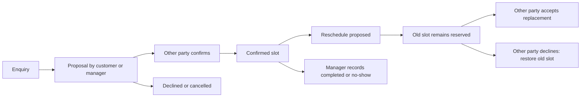

# Property enquiries, viewings and secure conversations

The backend now connects property discovery to a private enquiry, a mutually confirmed viewing, and ongoing conversation. It also supports lease discussions and service-job communication. All writes require an authenticated active account. Contacting a listing does not require a tenant profile or application, and does not create a reservation, approve an application, sign an agreement or collect money.

## Contact and enquiry

1. Sign in, then GET `/api/v1/listings/{listingId}/contact`. This returns `listingVersion` and the existing approved public listing projection. Hidden addresses remain hidden. Inactive, withdrawn, stale or unavailable listings return 404 using the existing listing visibility policy.
2. POST `/api/v1/listings/{listingId}/enquiries` with `requestId`, the reviewed `listingVersion`, and a plain-text `message`. The prospect receives a private `ENQUIRY` conversation. Current property owner/delegated-agency OWNER/ADMIN users receive a generic in-app notification.
3. Continue that thread through `/api/v1/conversations/{id}/messages`. One enquiry exists per prospect/listing; a different request cannot silently create another thread or append another initial message. An exact retry returns the existing conversation, including when the listing subsequently becomes unavailable. Existing threads can continue after publication ends so parties can discuss an earlier interaction.

Property managers cannot create customer enquiries for their own managed properties. Guests can still browse the existing public marketplace; contacting and arranging a viewing require login. No phone number, email address, tenant profile, private property ID/unit ID, ownership record or hidden location is automatically disclosed through these APIs.

## Conversation scopes

| Kind/channel | Customer | Current owner/agency OWNER/ADMIN | Current accepted provider OWNER/ADMIN |
| --- | --- | --- | --- |
| Listing enquiry / SHARED | Prospect | Yes | No |
| Executed lease / SHARED | Lease tenant | Yes | No |
| Maintenance / SHARED | Occupant | Yes | Yes, for the frozen assignment |
| Maintenance / PROCUREMENT | No | Yes | Yes, for the frozen assignment |
| Private service booking / SHARED | Booking customer | No | Yes, for the frozen assignment |

Lease discussions require a SIGNED, ACTIVE, COMPLETED or TERMINATED lease. Lease DRAFT/SENT records cannot open conversations. Parties can continue legitimate post-lease discussions, such as checkout follow-up. Lease conversations use one shared thread.

Work threads freeze their assignment and provider identity. A provider must accept the job before obtaining conversation access. A release, cancellation or reassignment removes that provider's access immediately. A replacement provider uses a different thread and cannot read the old assignment's messages. Pre-assignment discussions are also separate from later provider threads. Occupants cannot create/read procurement threads. Personal service booking conversations are excluded from property-manager inboxes.

Organization roles and property delegation are checked from current backend records on every request. Ordinary MEMBER users and unrelated organizations cannot read private threads. Delegation is an explicit handover of access to the property's customer/operational conversations: the new current agency can read those business records, and the previous agency loses access. Separate organization-internal chat is not provided by this feature.

Platform administrators have no automatic access to conversation contents. The narrowly scoped reported-message workflow below is the explicit exception. Conversation DTOs expose a context reference and role labels; provider conversations never add private lease/property/unit/tenant identity fields.

## Inbox, messages and preferences

| API | Purpose |
| --- | --- |
| GET `/api/v1/me/conversations` | All conversations currently accessible through your customer/management/provider roles |
| GET `/api/v1/me/conversations/summary` | Open/closed counts and unread conversation/message totals |
| GET `/api/v1/organizations/{org}/conversations` | Authorized organization inbox |
| GET `/api/v1/organizations/{org}/conversations/summary` | Organization inbox totals |
| GET `/api/v1/conversations/{id}` | Current authorized conversation and your unread/preferences state |
| GET `{conversation}/messages?after=0&limit=50` | Ascending message sequences for bounded polling/history |
| POST `{conversation}/messages` | Append a new plain-text message |
| POST `{conversation}/read` | Advance your private read cursor |
| POST `{conversation}/preferences` | Mute/unmute your own future conversation notifications |
| POST `{conversation}/close`, `/reopen` | Customer/manager controls with a current conversation version |
| POST `{conversation}/messages/{messageId}/redact` | Author withdrawal within 15 minutes |
| GET `{conversation}/history` | Shared activity history with safe action text |

Inbox filters: optional `kind=ENQUIRY|LEASE|WORK`, `status=OPEN|CLOSED`, `unreadOnly=true`, `limit` 1–100 (default 50), and nonnegative `offset`. Message reads use a nonnegative `after` sequence and `limit` 1–100 rather than offsets. Rendering clients must display bodies as text and escape them; the backend does not render HTML, execute markup, fetch links or generate external previews. Messages allow up to 4,000 characters, including ordinary newlines/tabs; blank text and other control characters are rejected.

Sending is append-only and does not require an old inbox version: concurrent distinct messages both receive unique monotonically increasing sequences. `requestId` prevents duplicate delivery of retries. `senderRole` is a frozen CUSTOMER/MANAGER/PROVIDER label; `mine` is calculated for the current reader. Emails, phone numbers, author account identifiers and authentication data are not message response fields. Users can still choose to include personal information in message text, which is shared with the authorized recipients.

Unread counts exclude your own messages. `read.throughSequence` cannot exceed the current last sequence and never moves backwards. Read cursors and mute settings are personal; counterparties do not receive read receipts or see your mute settings. Muting suppresses future ordinary conversation/viewing inbox notifications, while unread counts continue to reflect new messages. Case-status notifications are sent directly to the reporter and are separate from ordinary conversation mute preferences.

Customers/managers can close or reopen a conversation; providers cannot close the channel on behalf of customers. Sending and new viewing proposals are unavailable while closed. Active viewings must be cancelled or given an outcome before closing their enquiry. Closing and author withdrawal preserve original evidence. Withdrawn/moderated messages return `body: null` with `redacted: true`; they are not deleted from the database. There are no message-edit, arbitrary user-to-user chat, attachment or public chat endpoints.

## Viewing workflow

POST `{conversation}/viewings` creates a proposal; the same party cannot confirm its own side's proposal. A different administrator in the same manager organization is still the manager side, not the customer. A proposal must be strictly in the future, last 15 minutes–2 hours, and finish within 90 days. Submit the reviewed current `listingVersion`, explicit `meetingInstructions` and a reason. Instructions are deliberately supplied by an authorized party; the backend does not copy a hidden property address into them.

Only one active viewing may exist per enquiry. PENDING proposals reserve no time. Confirmation rechecks current listing visibility/version, checks overlapping confirmed appointments for the unit and visitor, and atomically reserves the slot. Adjacent appointments are allowed. A visitor cannot be confirmed at two different properties at overlapping times, even when managers confirm concurrently.

Rescheduling a CONFIRMED appointment creates an immutable new proposal and sets `RESCHEDULE_PENDING`; the previously confirmed slot remains reserved until the other party accepts or declines. The replacement slot is checked for conflicts when accepted. Declining restores the previous confirmed proposal; cancelling frees the reservation. Confirming a stale/hidden listing requires a fresh proposal after reviewing the listing. Cancellation remains available when the listing is no longer public.

Only property managers can record COMPLETED/NO_SHOW, after the confirmed appointment ends. These are operational attendance records, not a verified transaction or proof eligible for reviews. Past confirmed appointments cannot be cancelled to replace their outcome. Arranging/finishing a viewing never creates an application, grants lease rights, changes inventory availability or bypasses application review.

| Viewing API | Purpose |
| --- | --- |
| GET/POST `{conversation}/viewings` | Authorized enquiry appointment history / initial proposal |
| GET `{conversation}/viewings/{id}` | Current proposal plus retained confirmed slot |
| POST `.../{id}/reschedule` | New immutable proposal |
| POST `.../{id}/confirm`, `/decline`, `/cancel` | Confirm the other party's proposal, decline or cancel |
| POST `.../{id}/complete`, `/no-show` | Manager-recorded attendance outcome |
| GET `.../{id}/history` | Append-only proposal/decision history |
| GET `/api/v1/me/viewings` | Appointments accessible through your current roles |
| GET `/api/v1/organizations/{org}/properties/{property}/viewings/calendar?from=...&to=...` | Private manager calendar |

Personal viewing filters support `status`, optional paired `from`/`to`, `limit`/`offset`. Calendar windows must be positive and no larger than 31 days. Calendar responses retain cancelled/past outcomes when they fall within the requested range, so clients must use status/confirmedSlot to distinguish reservations from history. There is no anonymous availability calendar and no disclosure of other prospects' identities or appointment details through overlap errors. Named host/agent capacity, group tours, calendar integrations and travel-time calculations are future work.

## Reported-message moderation

Participants can POST `{conversation}/messages/{messageId}/reports` with a request ID, category (`SPAM`, `HARASSMENT`, `FRAUD`, `OTHER`) and private reason. A user cannot report their own message; one report exists per reporter/message. Report creation is private and is not placed in the shared conversation timeline or sent to the reported party.

GET `/api/v1/me/conversation-reports` or `/{reportId}` exposes only your own report status/reason/resolution. A reporter retains that case-status record if their conversation access later ends; this does not restore message history. Moderators see a metadata-only queue at `/api/v1/admin/conversation-reports`: case ID/category/status/version/assignedToMe/createdAt, without conversation contents, report reason, reporter identities or contact data.

An independent PLATFORM_ADMIN password-confirms POST `/{reportId}/claim` with the case version and a reason. The operator must be independent of current conversation parties and past message authors. Claiming records an audit event and notifies the reporter generically. Only that currently assigned, independent operator can GET `/{reportId}/evidence`, and each evidence read is audited. Evidence contains the single reported original message and the case; it does not expose other messages or grant the conversation API permissions. This narrowly scoped original-evidence access continues after author withdrawal/redaction and resolution for the assigned case.

POST `/{reportId}/resolve` requires the current case version, password, a reason and `resolution=REDACT|NO_ACTION`. REDACT withholds the message from ordinary readers, preserving the immutable original. NO_ACTION resolves the report without changing the conversation. Decisions are retained, and the reporter receives a generic status notification. Becoming a business participant after assignment removes evidence/decision access; the operator can still release the case.

POST `/{reportId}/release` allows the assigned operator to return an unresolved case to OPEN. Evidence access ends immediately; another independent operator must claim it. An exact authorized retry of the release returns the case metadata and never restores evidence access. Queue filters include `status=OPEN|ASSIGNED|RESOLVED`, `mine=true` and bounded pagination. Administrative claim/release/resolve requests share authentication password-attempt throttling. No administrator is bootstrapped and no public role-grant endpoint is added.

Moderation here concerns communication abuse. It does not resolve tenancy/service/payment disputes, freeze or refund money, reverse signatures, ban accounts, or certify identity/KYC. Existing work-dispute and financial workflows remain authoritative for those actions.

## Consistency, notifications and security

All mutations carry a UUID `requestId`. Keys are scoped and bound to actor, action, target and canonical payload; altered reuse returns 409. Passwords are recursively excluded from stored fingerprints, but password-confirmed retries still require the current correct password. Close/reopen use the current conversation `version`. Initial viewing creation uses the current conversation version; later viewing commands use the appointment's independent `version`. Report moderation uses the case's version. Sending, read cursors, preferences and message reports do not require a stale inbox version.

Property row locks serialize communication with listing changes, membership/delegation-sensitive work writes and appointments. Manager writes follow organization → property order, provider writes property → provider organization, and authorization is rechecked after waiting. A transaction-scoped visitor mutex prevents overlapping confirmations at different properties without locking another property's row. A separate enquiry-customer mutex enforces the hourly prospect limit across listings. Message rate checks serialize within their conversation/property transaction.

`ZAZA_MESSAGES_PER_MINUTE` defaults to 30 per actor/conversation in a rolling minute. `ZAZA_ENQUIRIES_PER_HOUR` defaults to 20 per prospect across listings in a rolling hour. Invalid limits fail startup. Exceeding them returns 429; an exact successful retry does not create another message or consume another send. Authentication throttling remains separate.

Conversation messages, redactions, operations, shared/private events, reported-message decisions, viewing proposals and viewing history are protected against updates/deletes/truncation by PostgreSQL triggers. Conversation context/customer/provider identity, report source evidence and viewing identity are immutable. Account preferences/read cursors and current state/version projections are mutable by authorized commands. Database owners can bypass triggers; use restricted runtime credentials and deployment-level database/storage encryption, backups and TLS in production. This feature does not claim end-to-end encryption or add file storage.

New messages, appointments, state/version changes, idempotency records, audit entries and targeted notifications commit together. Notification previews contain generic action text and a private deep link, never message bodies, reasons, meeting instructions, contact data, bank details or hidden addresses. Existing application/lease/work/service-finance inbox fields and event-source checks remain supported; the new additive fields are `conversationId` and `conversationUrl`. Every new private API response sends `Cache-Control: no-store`.

## Run and validate

Migration V13 extends the current V1–V12 backend. No external credentials, communications providers or new dependencies are required. Start with the existing `.env` and `scripts/start-local.ps1`; optional communication rate settings can be placed in the environment or `.env`.

`api/enquiries-viewings-conversations.http` supplies role-separated manual requests. The current implementation is persisted HTTP messaging with sequence-based polling. Flutter inboxes, viewing screens, WebSocket delivery, email/SMS/push delivery, attachments, email/phone verification and external calendar integrations remain separate work. No external messages are sent by this feature or by the tests.

Run `scripts/test-foundation.ps1 -UseLocalDatabase` with Java 24. Real HTTP/PostgreSQL tests remain isolated in `zaza_foundation_test` with generated users/content and no live appointments or external communications. Tests cover scope isolation, retries, concurrent messages/confirmations, slot retention during rescheduling, ownership/delegation changes, source immutability, moderation privacy and audit rollback.
