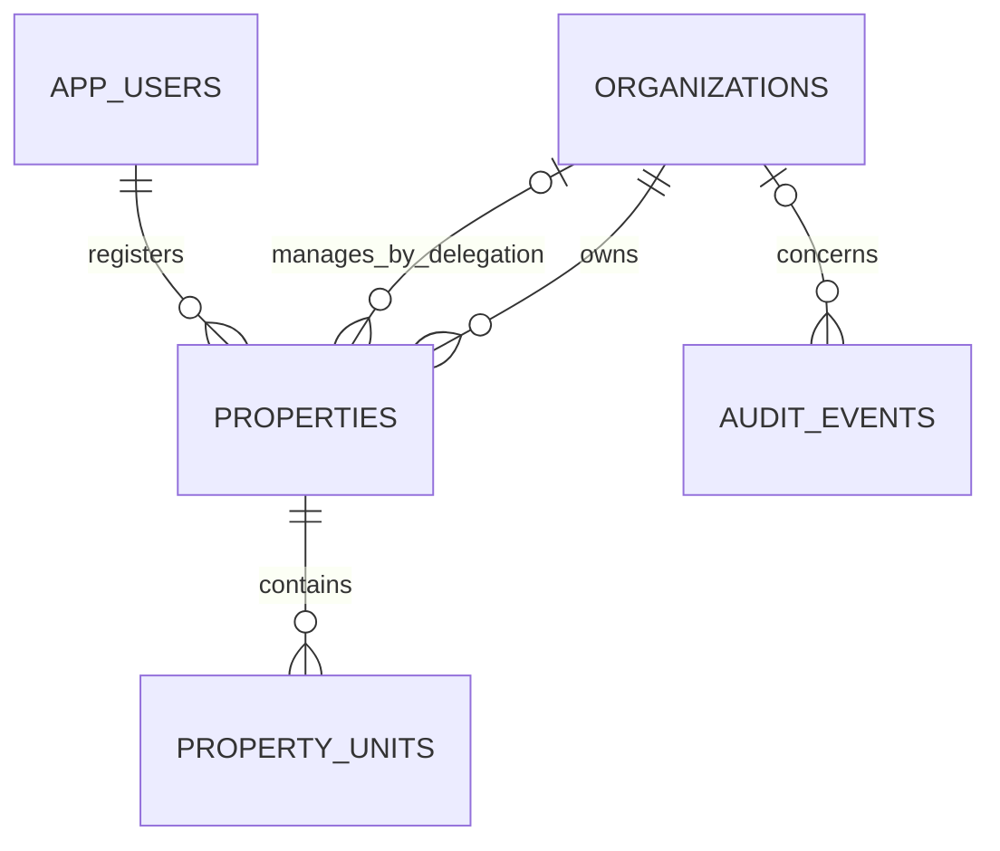

# Property and unit management

This is the first part of the property marketplace: private property inventory and rental units. Branch: `feature/property-management`.

## Start and try it

From your backend project folder:

```powershell
.\scripts\start-local.ps1
```

Flyway applies migration V2, adding `properties` and `property_units`. V1 is unchanged. Restart an already running backend to load the new code and migration.

Use `api/foundation.http` to register, log in, and create a `LANDLORD` or `AGENCY` organization. Then use `api/property-management.http` to register a property, add units, set prices and availability, and manage archival or agency delegation. All endpoints require a bearer token. Keep actual credentials/tokens in a private HTTP client environment.

## Workflow

1. Register a property in an organization you manage. That business becomes the immutable owning account, separate from the creator. An agency can register its own inventory.
2. Add units with labels unique within the property, ignoring letter case and surrounding whitespace. Archived units retain their labels.
3. Set internal property status to `ACTIVE` when ready to manage it. This does not publish a public listing.
4. To delegate a property's management, the owning organization's owner/admin assigns a separate registered agency organization ID. That agency works through its own organization URL.
5. Remove the delegation by sending `managerOrganizationId: null`. Subsequent agency requests lose access to that property and its units. Revocation is allowed while archived.
6. Archive to retain history. An archived property freezes edits and unit mutations until restored. Property restoration does not restore individually archived units.

Ownership records a business-account association supplied by the creator, not verified legal title. Co-owners, ownership transfer, agent-level permissions, and management-invitation acceptance remain future work. Assignment immediately shares this property's metadata and units with the selected agency's members.

## Permissions

| Actor | Read assigned inventory | Edit details and units | Change property status or agency delegation |
| --- | --- | --- | --- |
| Owning organization OWNER / ADMIN | Yes | Yes | Yes |
| Owning organization MEMBER | Yes | No | No |
| Delegated agency OWNER / ADMIN | Assigned properties only | Yes | No |
| Delegated agency MEMBER | Assigned properties only | No | No |
| Unrelated organization / platform admin without membership | No | No | No |
| Guest | No | No | No |

`SERVICE_PROVIDER` organizations cannot register properties or receive management delegations. Delegation does not grant access to the owner's other properties, membership details, or business data. Unauthorized organization/property requests return 404; authorized readers without mutation permissions receive 403. Revoking membership takes effect on subsequent requests, even with an existing session.

## API

All paths start with `/api/v1/organizations/{organizationId}/properties`.

| Method | Suffix | Behavior |
| --- | --- | --- |
| POST | Empty | Register property; starts DRAFT, version 0 |
| GET | Empty | List owned/delegated properties |
| GET / PUT | `/{propertyId}` | Read / replace editable details |
| PATCH | `/{propertyId}/status` | Set DRAFT / ACTIVE / ARCHIVED |
| PATCH | `/{propertyId}/management` | Assign separate agency or remove delegation |
| POST / GET | `/{propertyId}/units` | Create / list units |
| GET / PUT | `/{propertyId}/units/{unitId}` | Read / replace unit details |
| PATCH | `/{propertyId}/units/{unitId}/status` | Set ACTIVE / ARCHIVED |

Lists accept `limit` (1-100, default 50) and `offset` (nonnegative). Properties support `status`, `type`, and case-insensitive exact `city` filters; default omits archived properties. Units support `availability` and `includeArchived=true`; default omits archived units. An authorized GET by ID can read archived records.

Create bodies are the detail objects in the HTTP examples. PUT bodies use `{"version":0,"details":{...}}`. Every PUT/PATCH requires the current record version. Successful mutations increment it. Stale versions return 409; reload and review changes before saving. PUT replaces all editable details, clearing optional fields omitted from the body. Ownership, parent property, status, and delegation cannot be changed through detail updates.

Property types: `APARTMENT`, `HOUSE`, `COMMERCIAL`, `LAND`, `MIXED_USE`. Location requires country code, city, and address. Optional latitude/longitude must be supplied together, within valid ranges, with up to seven decimal places. ISO alpha-2 country codes are normalized to uppercase. Coordinates are stored; maps/geocoding integration remains future work.

Units require a label, bedroom/bathroom counts (zero is allowed for studios), monthly rent, deposit, ISO currency, and availability. Optional floor area is in square metres. Prices use exact decimal storage with up to two decimal places, up to twelve digits before the decimal, and nonnegative amounts. This rental model does not include sale prices or varying currency minor-unit precision. Currency is explicit, not fixed to Kenya.

Availability: `AVAILABLE`, `RESERVED`, `OCCUPIED`, `UNAVAILABLE`. It is manually managed until applications and leases are implemented; RESERVED does not create a booking/hold. Archival replaces destructive deletion APIs.

Invalid input returns 400; invalid authentication 401; forbidden actions 403; inaccessible or mismatched parents 404; duplicate labels, stale versions, and edits to archived records 409.

## Audit and data model

Every successful creation, edit, status change, and delegation change appends structured previous/new snapshots to the protected audit log in the same transaction. Agency actions are attributed to the acting agency. Failed mutations do not append success events. Mutation locks recheck current membership and delegation; version checks prevent silent overwrites.



## Verification

```powershell
.\scripts\test-foundation.ps1 -UseLocalDatabase
```

Runs both foundation and property integration suites against the separate `zaza_foundation_test` schema and builds the executable jar. Tests do not use application tables in `public`. Coverage includes permissions, delegation/revocation, archival/restoration, duplicate labels, pricing, versions/concurrent writes, mismatched parents, validation, audits, pagination/filters, and browser PUT preflight.

## Next marketplace work

Public listings/search, media storage, protected ownership documents, maps display, verified ownership/onboarding, and Flutter integration remain subsequent work. No sample properties are inserted into application data automatically.
